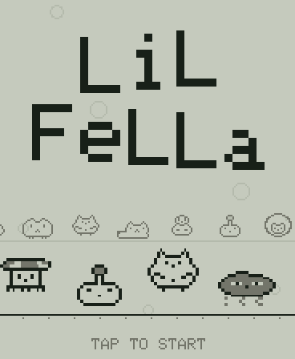
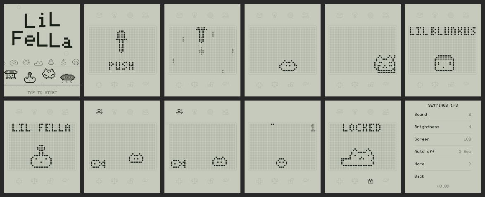

# Lil Fella (v1.0.1)

A classic, 2-bit virtual pet for the **Waveshare ESP32-S3-Touch-AMOLED-2.16**, the
**ESP32-S3-Touch-AMOLED-1.8 (V2)** and the **ESP32-S3-Touch-LCD-1.83**: a 40x28 dot-matrix "LCD" in four shades of
grey, eight icons around it, and a blob drawn from hand-made graph-paper sprites.

The title screen (new in v0.09): shown once the clock is set on a brand new device. All ten Lil Fellas parade past to a
looping tune; tap to start.

**Wiki:** [docs/wiki](docs/wiki/Home.md) is the player's guide: getting started, caring, growing up, the mini-games,
settings, endings and flashing, plus [every status effect](docs/wiki/Status-Effects.md) with pictures and
[POP](docs/wiki/POP.md), the bubble shooter.

## Boards
| | AMOLED-2.16 | AMOLED-1.8 | LCD-1.83 |
| --- | --- | --- | --- |
| PlatformIO environment | `amoled216` (the default) | `amoled18` | `lcd183` |
| ready-built image (in `firmware/`) | `lil-fella-v1.0.1-amoled216-merged.bin` | `lil-fella-v1.0.1-amoled18-merged.bin` | `lil-fella-v1.0.1-lcd183-merged.bin` |
| panel | 480x480 AMOLED | 368x448 AMOLED | 240x284 IPS LCD (ST7789) |
| the game's picture | 368x448 in the middle, LCD background around it | the whole panel | scaled to 230x280 (5 panel pixels for every 4 of the frame's, smoothed), a thin border around it |
| touch | CST9220 | CST816 (V2) / FT3168 | CST816 |
| brightness | panel command | panel command | backlight PWM (GPIO40) |
| buttons that wake the screen | PWR, BOOT, the extra key (GPIO18) | PWR, BOOT | PWR, BOOT |

The game is the same on all three, and comes out about the same physical size (about 29 x 35 mm); only `src/hal/`
and the build settings know which board it is (`src/hal/board.h` has the pin maps). **The 2.16 and LCD-1.83 builds
compile but have not been run on a board yet**: see [First run on the 2.16](#first-run-on-the-216) and
[First run on the LCD-1.83](#first-run-on-the-lcd-183).

## Build & flash
**Ready-built (no build tools needed):** flash your board's image (the table above) at address `0x0`, either in a
browser (Chrome/Edge: Espressif's ESP Tool web page, https://espressif.github.io/esptool-js/ → Connect, add the file at
`0x0`, Program) or with `esptool --chip esp32s3 write-flash 0x0 <the file>`. If the port isn't found,
hold BOOT, tap RESET, let go of BOOT. The images were built with Arduino-ESP32 3.3.8 and GFX Library for Arduino 1.6.9
(ESP32-S3, 16 MB QIO flash, OPI PSRAM, USB CDC on boot, partitions `default_16MB`); the 2.16 one also uses SensorLib 0.3.3.
An image for the wrong board does no harm, it just shows nothing useful: flash the right one over it.

VS Code + PlatformIO: open this folder, pick the environment for your board in the status bar (`amoled216` is the
default) and click **Upload** (hold BOOT, tap RESET if the port isn't found).
Command line: `pio run -e amoled216 -t upload && pio device monitor` (or `-e amoled18`, `-e lcd183`). Pushing to
GitHub builds `lil-fella-amoled216-merged.bin`, `lil-fella-amoled18-merged.bin` and `lil-fella-lcd183-merged.bin`
(flash at `0x0`).
Saves live in NVS and survive re-flashing. What's new in each version: [docs/CHANGES.md](docs/CHANGES.md).

### First run on the 2.16
The port follows Waveshare's own demo for the board (same pins, same display and touch set-up), but nobody has
watched it run yet. With the serial monitor open (`pio device monitor`), check these in order:
1. **Boot log:** `[hal] board AMOLED-2.16, panel 480x480, game picture at 56,16`, then `touch @0x5A ok (CST9220)`,
   `imu off`, `power chip ok`, `rtc ok`. `touch not answering` means the touch chip didn't start.
2. **Picture:** upright, in the middle, with an even border. If it's turned or mirrored, change `LCD_MADCTL` in
   `src/hal/board.h` (`0xA0` is the demo's value; `0x00` is the panel's own orientation).
3. **Touch lands where you press:** Settings → **Touch: DEBUG** draws a ring under your finger, and the monitor prints
   `[touch] x,y` in panel pixels (0,0 = top left, 479,479 = bottom right). If it's turned or mirrored, change
   `TOUCH_SWAP_XY` / `TOUCH_MIRROR_X` / `TOUCH_MIRROR_Y` in `board.h`.
4. **Holding and dragging:** hold the LCD ~1 s for Settings, and drag in MOVE. If a held finger seems to let go and
   press again, raise `TOUCH_HOLD_MS` at the top of `src/hal/board.cpp` (70 ms now).

### First run on the LCD-1.83
Pins and display set-up are from Waveshare's demo repo for the board; nobody has watched this build run yet. With
the serial monitor open, check these in order:
1. **Boot log:** `[hal] board LCD-1.83, panel 240x284, game picture 230x280 at 5,2`, then `touch @0x15 ok`,
   `imu off`, `power chip ok`, `rtc ok`.
2. **Picture:** fills the screen with a thin even border, colours right (light grey LCD, black ink). A strip of
   noise at the top or bottom, or the picture sitting too high or low: change `LCD_ROW_OFFSET` in `src/hal/board.h`
   from `0` to `20` (Waveshare's own sketches disagree on it). Colours inverted: change `true /* IPS */` to `false`
   in `src/hal/board.cpp`.
3. **Brightness:** Settings → brightness should dim the backlight, and the screen should go dark on auto off. If the
   backlight only does on/off, say so: the pin may not take PWM on this board.
4. **Touch lands where you press** (Settings → **Touch: DEBUG**; the monitor prints `[touch] x,y`, 0,0 = top left,
   239,283 = bottom right), and **holding and dragging** work (`TOUCH_HOLD_MS`, as on the 2.16).
5. **Sound:** the boot log should say `[audio] ok`, and Settings → Sound should coo as you change it (a speaker
   must be plugged into the speaker header).

## How to play
| icon | does |
| --- | --- |
| **Feed** (fish + bowl) | serves a meal (refused when completely full). Lil Blob absorbs its food; every other look has its own eating routine. Big Blorbus never gets hungry: their Feed icon is ORBIT CATCH (eat the planets, dodge the spiky ones; 3+ hearts earns a snack) |
| **Light** (bulb) | a switch: tap to turn the light off or on. They sleep at bedtime (see below) and want the light off; Leave it on for more than 15% of their night's sleep and they wake up **sick**. Turning it off in the day just makes it dark (a tap on the LCD shows the time) |
| **Play** (yarn) | four games. **MOVE**: things fall from the ceiling; slide your finger anywhere to move them (one hit ends it; 27-30 s is perfect). **RUN**: a side-scroller; tap to jump (and again in the air for a double jump: a card says so before the run starts). Power-ups turn up at a different height and distance every time. **YEET**: press anywhere and drag back to stretch the sling (a dotted line shows the way), let go: trampolines, springs, bumpers and gusts help, rocks, birds, clouds and mud don't; score in metres, best saved. **POP**: a bubble shooter after Puzzle Bobble: slide a finger to aim, let go to fire, match three of a kind (X, triangle, diamond, empty, black) to pop them; clear the field before the ceiling pushes it over the line. POP has the whole screen: the icons are put away, the LCD is taller, and BACK (top right) leaves ([how to play](docs/wiki/POP.md)). Each raises happiness by how well it went (up to 4 hearts) |
| **Medicine** (hollow +, bottom row, second from the left) | one dose cures one sickness (they stack: "1 MORE" until the last). The dose works the moment you give it and the animation can't be cut short. Refused when they're not sick |
| **Clean** (soap, top right) | scrub it: rub your finger back and forth over the long litter box and the floor mess. The poop nearest your finger wears away; every poop is a different shape and some are stuck-on (crusty, or with flies: up to twice the rubbing). Every poop they've done since the last clean is in there (up to 12 in the box, 4 on the floor), and each one is more to scrub: about 2 s for one, 15-30 s for a box left to fill up; you can't fail. Leave before it's clean and the scrubbing you've done is kept for when you come back |
| **Meter** (scales, bottom left) | name, age and the battery charge (a percentage), HUNGRY, HAPPY, TRUST, then gifts, sicknesses and stage. Tap the LCD for the next page |
| **Lock** (padlock) | asks LOCK? (YES / NO). Locked, your Lil Fella stays exactly as they are: they don't age, don't grow into the next stage and can't die. Everything else carries on (they still get hungry, messy, sick and sleepy, and still call for you). The padlock icon stays lit while locked. Tap it again to UNLOCK? and life goes on from where it stopped |
| **Attention** (blob + !) | lights up when they need something; tap it to see what (nothing shows when they're happy) |

- **Tap the fella** to pet them. From Lil Blunkus on they sometimes go **exploring** (a goo trail on the floor) and
  come back with a found treasure (a flower, shell, pebble, berry or a rare gem): tap it to take it (THANKS!).
- **Games are free.** There is no energy: play as many games as you like, nothing wears them out, and they never
  nap from tiredness. The only daytime nap is a Lil Blob's test nap (the light lesson); see the [wiki](docs/wiki/Status-Effects.md#napping-in-the-day).
- **Sick?** They get sick when hunger hits empty or the light stays on through their night (plus one starter bug in the
  first 5 minutes, which doesn't count). The body goes speckled and droopy, with an icon by the head for each kind
  (germ, crossed-out bowl, lit bulb) and a number when there's more than one.
- **The litter box** shows up (bottom right) only while there's poop in it waiting to be cleaned. Tap it to clean it. **Tap an empty spot** to see the time (in the dark too: any tap on the LCD). **Hold the LCD** ~1 s for **Settings**: page 1 sound (each tap is one step quieter), brightness, LCD
  or night palette, auto off, More; page 2 old friends, journal, clock, debug speed, More; page 3 new blob,
  **erase everything** (every fella, old friends and settings, back to the first-start clock page) and touch debug.
  The **Journal** marks every look you've raised, by stage.
- **Auto off:** left untouched, the screen turns off after **5 Sec**, **15 Sec**, **30 Sec** (default) or **1 Min**; **Never**
  keeps it on (it dims after 45 s untouched). Never during setup, a game or the look picker; a game left untouched
  for 30 s goes back home.
- **Turning the screen on** takes a tap or the PWR / BOOT button; picking the device up doesn't. The waking tap only
  turns the screen on (it doesn't also press anything). Things that happen while it's off (a poop, growing up, an
  ending) are waiting when you look.
- A new blob gets a random name from the list in `src/game/game.cpp` (NEW NAME for another, or keep it).
- When they go to the litter box you see them walk over, squat and step out (if you were in a menu, it plays when you're back).

### The first hours
Like the 2nd-generation Tamagotchi, the Lil Blob teaches you its care. Every few minutes (while awake) it asks for something
new: HELLO!, HUNGRY, MESSY, BORED, CHECK ME, each answered with a different icon. Two more come on a schedule:
a **starter bug** in the first 5 minutes (cure it with the medicine) and a **sleepy** nap at 6-9 minutes old (turn the light off while they sleep). Those two only count when done for real, and come round again until they are.
It only grows into a Lil Blub once the 7 care icons have been used (Lock isn't a lesson). It also has to be an
hour old. That's an hour by their own clock, which runs a little fast while they're hungry or unhappy: with someone
who only does the lessons it's 45 minutes after the drop lands (`./sim blub` plays it through), and it's nearer the
full hour for a blob that's kept fed and happy. One made at night falls asleep at 30 minutes, so it grows up in the
morning.

Upkeep is busiest at the start and eases off as they grow:

| | poops | good moments | from full to empty |
| --- | --- | --- | --- |
| hour 1 | every ~3 min at first | 4-5 | about an hour |
| Lil Blub | every ~6 min | every 30-50 min | 2-3 h |
| Lil Blunkus | every ~10 min | every 50-80 min | ~5 h |
| Lil Fella | every ~15 min | every 80-140 min | ~9 h |

There's no random sickness: going empty or a lit night is what makes them sick, so the first days (when hunger drains
fastest) need the most looking after.

Poops need something in the tummy, and at night they hold it until morning.

**Bedtime:** Lil Blob 8pm-10am, Lil Blub 9pm-9am, Lil Blunkus 9:30pm-8:30am, Lil Fella 10pm-8am. Overnight their needs
barely drop. A brand new Lil Blob's bedtime waits 30 minutes: one made during sleep time falls asleep 30 minutes afterwards (its test nap still comes at 6-9 minutes, and can run on into the night). When they fall asleep they want the light off (the SLEEPY call); leaving it on for 15 minutes is a care
mistake, and for more than 15% of the night, a sickness. They wake in the morning and the light comes back on (woken in
the night to be fed, it stays off).

### Growing up
A new blob starts in a lab **eyedropper**: push it (tap the LCD) and a drop squeezes out and falls a long way,
past the clouds, then splats on the floor: the goo spreads out, pulls itself back together (eyes first), springs up too
tall, squishes and wobbles until it settles as the
**Lil Blob** (baby) → **Lil Blub** at 1 hour → **Lil Blunkus** at 1 day → **Lil Fella** at 3 days → **Big Blorbus** (from 8 days, for some looks). Before each new stage they pulse bigger and smaller among stars, then **you pick the look** ("Pick new form:"; arrows to flip through, tap the fella to choose); they keep
their old look until you pick. Growing up waits until they're awake with the light on: a stage reached in their sleep starts when they wake.

| stage | looks |
| --- | --- |
| Lil Blub | Blobbert, Mochi, Cheeks |
| Lil Blunkus | Bean, Bun, Curly, Sprout, Slosh, Wobbles, Mallow, Toasty |
| Lil Fella | Dapper, Loaf, Puddle, Jelly, SpikyBoi, Puff, Marshy, Boop, Fubz, Nimbus, Ballboi |
| Big Blorbus | Blobbert, Ballboi, Alien Cat in a Tuxedo |

Each pick limits the next (the evolution tree).

A hidden breed (decided by care at 1 day old) changes them a little under the hood; a Void one is drawn filled in dark grey.

### The end, and a new blob
Every life ends the same way: they melt into a puddle of liquid and the dropper (God) takes them back.

| ending | when |
| --- | --- |
| **Recycled** | a well-kept Lil Fella, after about a month (poor care ages them faster) |
| **Overfed** | fed far too much for far too long (a hidden limit) |
| **Too sick** | health runs out: each untreated sickness wears it down (about 30 awake hours for one alone, faster when they stack or the mess piles up) |
| **Too sad** | 12 awake hours in a row at zero happiness (a sad sound at 6 h; cheering them up to half happy clears it) |
| **Lost trust** | trust runs out (this used to be "ran away") |

First the caption (BYE BYE / THANK YOU with sparkles when recycled; otherwise OH NO and the reason), then they slowly
dissolve into a puddle. The dropper comes down over it and waits, with PUSH blinking: **press to squeeze the bulb, let go
and it sucks the puddle up** (a tap does both). It rises and the name page opens: name the new blob and push the
dropper again to squeeze them out.
Health only drops while they're awake, so a night's sleep is always safe, and being away (device off) never ends a life.
In the simulator a player who checks in every 4 hours (or every 7 hours in the day) gets a full life; once or twice a
day isn't enough for a young fella.

**Old friends** (Settings page 2) remembers the last 8: their look, name, how it ended and how old they were, plus how
many blobs you've raised in all.

## Touch: controller defaults
- AMOLED-1.8: no CST816 register writes, no release debounce. 2.16: the CST9220 is set up as in Waveshare's demo and
  read by polling. LCD-1.83: the CST816 is reset and read at its defaults. On the 2.16 and the LCD-1.83 a finger counts
  as lifted once nothing has been read for 70 ms (`TOUCH_HOLD_MS`), and a touch on the border around the picture counts
  as its nearest edge. An icon is chosen by where the finger rested over the whole press, not the first spot it touched (a fingertip lands on its edge and rolls flat, which could turn Meter into Medicine). A tap = press and release within 24 px (or 40 px for a quick tap under
  0.3 s); a long press = 1.2 s. Things on the LCD can be hit from up to 5 dots (~3 mm) away and the nearest one wins.
  All of these are at the top of `src/game/game.h` (`TOUCH_TAP_SLOP`, `TOUCH_QUICK_*`, `TOUCH_REACH`, `TOUCH_LONG_MS`).
- Touch is also polled between frames, so very quick taps aren't missed. When two things overlap, the one whose middle
  is nearer the finger wins. `./sim touchmap` checks every icon pixel, page row and home-screen object.
- The boot log says which address answered (0x5A CST9220 on the 2.16; 0x15 CST816 or 0x38 FT3168 on the 1.8); while you touch, `[touch] x,y` is printed
  (max 4 lines a second). Settings → **Touch: DEBUG** draws a ring where the controller says your finger is.
- Optional tweaks at the top of `src/hal/board.cpp`, for the 1.8: `TOUCH_KEEP_AWAKE` (disable CST816 auto-sleep +
  continuous reporting) and `TOUCH_RELEASE_DEBOUNCE` (ignore up to 2 dropped samples).
- Sound is on (`-DLF_AUDIO=1` in `platformio.ini`; with `0` the audio code isn't even compiled in): 40 synthesised
  sounds (wet bloops, squelches and bubbles, no beeps; all defined in `src/game/synth.cpp`, shared with the web page) for
  every tap, menu, refusal, meal, poop, scrub, game and their voice. Up to four play at once. They go through the ES8311 codec and the speaker header, on all three boards. Settings → **Sound** sets the volume
  (0 = off up to 5 = max, default 2; it is quiet on purpose). The boot log says `[audio] ok`, or what failed.

## Motion sensor
Not used. The QMI8658 is put into its power-down state at boot (`[hal] imu off`) and never read; all the motion
code is gone from the game. Auto off goes by time untouched alone and lets an animation finish first; the ending
has no shakes; moving the device no longer wakes a napping Lil Blob (so no more grumpy YAWN).

## WiFi and Bluetooth
Both are off, always. Nothing in the firmware uses either radio, neither is ever started, and so nothing scans,
advertises or connects. `hal::begin()` makes sure of it at every boot and the boot log says so:
`[hal] radios: wifi off (never started), bluetooth off (never started)`.

## Project layout
| path | what |
| --- | --- |
| `src/game/` | portable game: `pet.cpp` (needs, sleep, poops, sickness), `game.cpp` (loop, care rules, lessons, save), `view.cpp` (LCD scenes, icons, animations, mini-games), `yeet.cpp` (the scrub and YEET), `pop.cpp` (POP, the bubble shooter), `eatfx.cpp` (every look's eating routine), `pages.cpp` (setup, settings, journal), `lcd.cpp` (4-shade frame + dot matrix) |
| `src/game/sprites_data.cpp` | generated from `art/sprites.py` (one character per dot) |
| `src/hal/` | board support for both boards: display, touch, IMU, RTC, NVS, audio (`board.h`: the two pin maps) |
| `sim/` | PC simulator: `make`, then `./sim shots <dir>`, `flows`, `endings`, `lessons`, `life`, `fuzz [seeds]`, `touch`, `touchmap`, `pop`, `v010` (the v0.10 fixes), `blub` (how soon a Lil Blob grows up), `wikishots <dir>` and `popshots <dir>` (the wiki's pictures), `growth`, `eat`, `tree`, `blorbus`, `journal`, `new` (sickness, medicine, scrub, YEET), `sessions <dir>` and `games <dir>` (balance playthroughs; `make simfast` builds a quicker binary for these) |
| `web/` | browser build (needs wasi-sdk): `./build.sh` makes `lil-fella.html` |
| `docs/wiki/` | the player's guide (17 pages), with pictures made by the simulator |

Rendering: a 184x224 frame of shades (1 byte each), expanded 2x to RGB565 through a small DMA strip; the palette
(classic LCD or night) is applied at that point. On the 2.16 that 368x448 picture is centred on the 480x480 panel
(the pixels are about the same size on both boards, so the fella is too) and the border is painted in the LCD's
background shade. On the LCD-1.83, whose pixels are bigger, the frame is scaled by 5/4 instead: every 4x4 block of
frame pixels becomes 5x5 panel pixels, blended by area, so each dot of the matrix is the same shape (the matrix is
lined up with the blocks) and text stays even.

## Editing the art
Change the ASCII grids in `art/sprites.py` (`X` dot, `E` eye, `M` mouth, `.` empty), then
`python3 art/sprites.py --cpp src/game` and rebuild. `python3 art/sprites.py sheet.png` renders a contact sheet.
