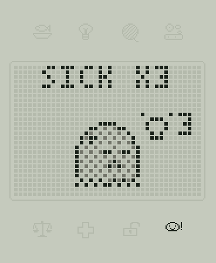

# Lil Fella wiki

A player's guide to **Lil Fella**, the 2-bit goo-blob virtual pet that lives on a touch screen.

You start with an empty screen and a drop of goo. From there you raise a Lil Fella: feed them, play with them, keep
them clean and healthy, watch them grow up, and see which of the many looks they turn into.

## Start here

- New to the game? Read [Getting Started](Getting-Started.md), then [The Screen and Icons](The-Screen-and-Icons.md).
- Want to keep your fella alive? [Caring for Your Fella](Caring-for-Your-Fella.md) explains every need, and
  [Endings](Endings.md) shows what goes wrong.
- Want the whole story of growing up? [Growing Up and the Evolution Tree](Growing-Up-and-the-Evolution-Tree.md)
  lists every look and how to reach it.

## All pages

| Page | What's in it |
| --- | --- |
| **Playing** | |
| [Getting Started](Getting-Started.md) | The title screen, the clock, naming, the dropper |
| [The Screen and Icons](The-Screen-and-Icons.md) | The eight icons, the Meter pages, taps and holds |
| [Caring for Your Fella](Caring-for-Your-Fella.md) | Hunger, happiness, mess, sickness, light and sleep, care mistakes |
| [First-Hour Lessons](First-Hour-Lessons.md) | The seven things a Lil Blob teaches you |
| [Growing Up and the Evolution Tree](Growing-Up-and-the-Evolution-Tree.md) | Stages, ages and every look |
| [Mini-Games](Mini-Games.md) | MOVE, RUN, YEET, POP, the scrub, Orbit Catch |
| [POP](POP.md) | The bubble shooter in full: how to aim, the five kinds of bubble, the ceiling, the hearts |
| [Exploring and Gifts](Exploring-and-Gifts.md) | Trips out and the treasures they bring back |
| [LOCK](LOCK.md) | Freezing your fella in time |
| **Reference** | |
| [Status effects](Status-Effects.md) | Everything that can be up with them, with a picture of each: the three sicknesses, weak, asleep, napping, every call of the attention icon, locked, exploring, Void, and how a life ends |
| [Endings](Endings.md) | The five endings and what happens afterwards |
| [Settings](Settings.md) | Every row on the three settings pages |
| [Old Friends and Journal](Old-Friends-and-Journal.md) | The record of the fellas and looks you have raised |
| **Hardware and software** | |
| [Supported Hardware and Flashing](Supported-Hardware-and-Flashing.md) | The three boards and how to flash them |
| [Web Version and Simulator](Web-Version-and-Simulator.md) | Playing without a board |
| **Help** | |
| [FAQ](FAQ.md) | Quick answers |

More in the repo: [boards and building](../../README.md), [what changed in each version](../CHANGES.md).

## The screen



| Where | What |
| --- | --- |
| Top row | Feed, Light, Play, Clean |
| The LCD | 40 x 28 dots. The fella, their mess, and anything they have to say |
| Bottom row | Meter (stats), Medicine, Lock, Attention (lit here: they're calling) |

## Keeping these pages up to date

The pictures are made by `sim/v010.inc` (`./sim wikishots <dir>` and `./sim popshots <dir>`) and turned into PNGs by
`docs/wiki/make-pictures.py`. After a change to how anything looks, run both again:

```
cd sim && make && mkdir shots && ./sim wikishots shots && ./sim popshots shots
python3 ../docs/wiki/make-pictures.py shots ../docs/wiki/img
```

These pages live in the repo (`docs/wiki/`) and read fine on GitHub as they are.
