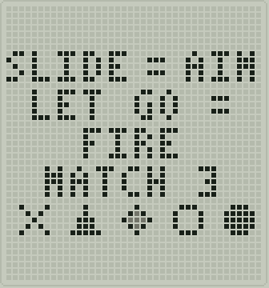
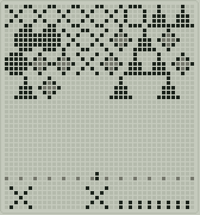
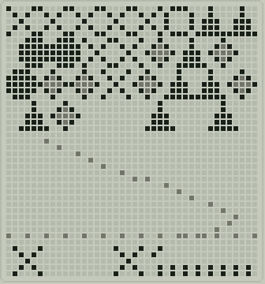
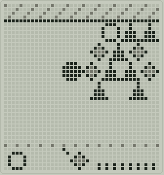

# POP

Play menu, bottom right. A bubble shooter in the manner of the arcade game Puzzle Bobble: aim, fire, match three.
POP has the whole screen: the icons are put away, the LCD is half as tall again (43 rows of dots, where every other
screen has 28), and the only button is **BACK**, top right.
(Until v0.10 POP was a different game, where you popped empty bubbles to let poop bubbles float away.)

  

## The five bubbles

The LCD has no colours, so the kinds differ by shape. They're on the bottom of the how-to card, in this order:

| X | Triangle | Diamond | Empty | Black |
| --- | --- | --- | --- | --- |
| a cross | a solid, pointed triangle | grey, with a black edge | a ring | filled right in |

## How to play

1. **Aim:** put a finger anywhere on the screen (but BACK) and slide it left and right. The middle is straight up; further
   over is a lower shot, up to 75 degrees either side. Your finger can wander anywhere once it's down, so it needn't
   cover the field. A dotted line shows where the shot will go, bounces off the side walls included.
2. **Fire:** let go. (A plain tap fires at once, toward where you tapped.)
3. The bubble sticks where it lands. **Three or more of the same kind touching pop.** Anything left hanging, with no
   way back to the ceiling, drops off with them.
4. Clear the whole field to win.

Bottom middle is the bubble you're about to fire; bottom left, the one after it. Both are always kinds that are still
on the field, so no shot is useless.

## The ceiling

The pips at the bottom right count the shots left before the ceiling comes down a row (8 shots each time; the last
pip blinks). When it does, everything moves down with it.

The dotted line across the screen is the limit. A bubble that ends up below it ends the game.

## Hearts

| Result | Hearts |
| --- | --- |
| Cleared before the ceiling moved | 4 |
| Cleared after it came down once | 3 |
| Cleared after that | 2 |
| Lost, but you popped at least as many as the field started with | 1 |
| Lost | 0 |

More hearts, more happiness for the fella. Like every game it costs them nothing: play as often as you like.

Tap **BACK** (top right) at any time to leave. Nothing else on the screen is a button while you play, so a finger
resting low to aim can't press anything by mistake.

## How hard is it?

From the simulator (`./sim pop`, 60 games each):

| Player | Fields cleared |
| --- | --- |
| A sure hand (always the best shot on offer) | 60 of 60, in about 10 shots |
| A shaky hand (the best shot, up to 7 degrees off) | 54 of 60 |
| Firing anywhere | 5 of 60 |
