# Status effects

Everything that can be "up" with a Lil Fella: what it looks like, what causes it, what it does to them, and how to
clear it. All numbers are from the game's rules (`src/game/pet.cpp`, `game.cpp`) as of v0.10. Every picture is the real
game, set up in that state and photographed by the simulator (`./sim wikishots`).

**Quick finder**

| You see | It is | Do this |
| --- | --- | --- |
| Speckled body, half-shut eyes, an icon blinking by the head | [Sick](#sick) | Medicine, one dose per sickness |
| A skull blinking by the head, body not speckled | [Weak](#weak-the-skull) | Feed, clean, keep them happy |
| Zs floating up | [Asleep or napping](#asleep) | Light off; let them sleep |
| A dark screen | [Asleep with the light off](#asleep) | Nothing. Tap to see the time |
| The attention icon (bottom right) is lit | [They're calling](#calls-the-attention-icon) | Tap it to see why |
| The padlock (bottom row) is lit | [Locked](#locked) | Tap it to unlock |
| No fella, three grey marks on the floor | [Out exploring](#exploring-and-gifts) | Wait 2-4 minutes |
| A body filled in dark grey | [Void](#void) | Nothing: it's who they are |

For comparison, a fella with nothing wrong: clear body, eyes open, no icons lit.

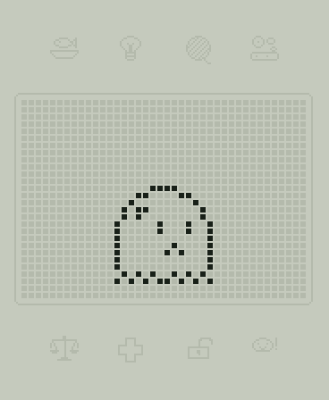

---

## Sick

There are three sicknesses. They **stack**: a fella can have several at once (up to 9), and each one needs its own
dose of medicine. There is no random sickness: only these three causes.

| | Starter bug | Hunger sickness | Light sickness |
| --- | --- | --- | --- |
| | 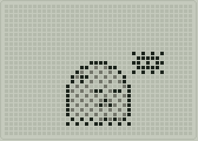 | 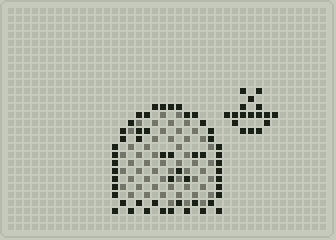 | 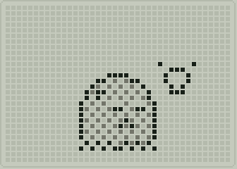 |
| Icon by the head | a germ | a bowl, crossed out | a lit bulb |
| Cause | Every new Lil Blob catches one at 2½ to 4½ minutes old. It's the medicine lesson | Hunger reached **zero** | The light was on for more than **15%** of a night's sleep (nights of 10 minutes or more). They wake up sick |
| Comes back? | Only if it went by without medicine while the lessons were still on | Once per empty tummy: it re-arms when they've been fed back up to a quarter full | Every lit night |
| Counts on the Meter's SICK total | No | Yes | Yes |

**What you see:** a speckled body, eyes half shut, a shiver now and then, and the sickness's icon blinking beside the
head. With more than one, the icon cycles through the kinds and a number shows how many. The attention icon lights;
tapping it says `SICK`, or `SICK X3`.

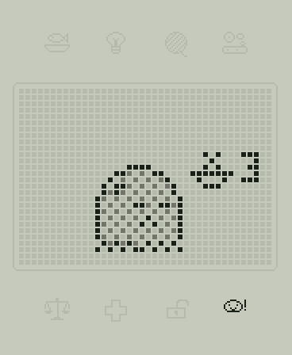 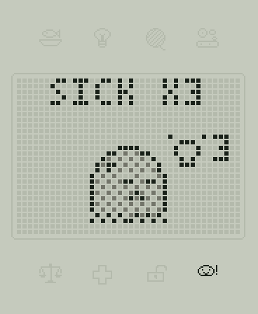

**What it does**

- The moment a sickness starts: **-25 health** (it never finishes them off on the spot: health stops at 1).
- Each untreated sickness: **-2.5 health per awake hour**. One alone takes about 30 awake hours to end a life; stacked
  ones are faster, and a dirty floor or box adds to it (up to 3.5 an hour per sickness in all).
- While sick, good care **doesn't** restore health. Only medicine does.
- Asleep, they lose no health: a night's sleep is always safe.
- Left unanswered for 15 minutes it counts as a care mistake, and another for every further hour (the starter bug
  never counts).
- Health at zero ends the life: **Too sick**.

**How to clear it:** the Medicine icon (bottom left). One dose cures one sickness and gives **+25 health** and a little
trust. It works the moment you give it, and the animation can't be cut short. Then `1 MORE` (or however many are
left), or `BETTER` after the last one.

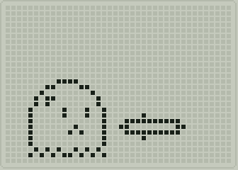 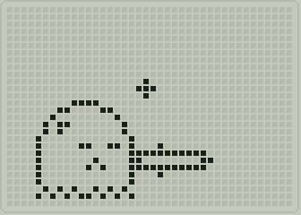 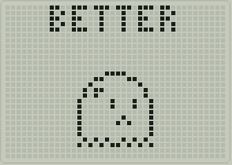

Medicine for a fella that isn't sick is refused: a shake of the head and a ×.

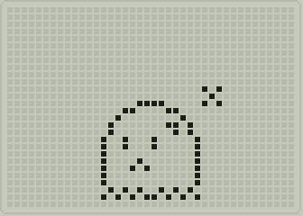

## Weak (the skull)

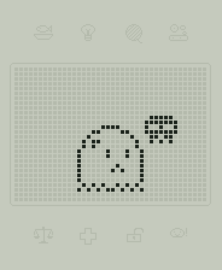

**What you see:** a skull blinking beside the head, on a fella that is *not* speckled. It means health is under 20
(of 100) with no sickness to blame.

**Causes** (health lost per awake hour):

| Cause | Loss |
| --- | --- |
| Hunger at zero (before it has made them sick) | 2 |
| Mess on the floor for more than 20 minutes | 1, or 2 with three or more |
| Four or more poops in the litter box | 1 |
| Badly overfed | 1, or 3 when it's extreme |

**How to clear it:** there's nothing to cure, so medicine is refused. Health comes back at **+5 an hour** while they
are well kept: at least a third full, happiness above 30, nothing on the floor, fewer than three in the box.

Low health also makes them age faster (from health 70 down), so a weak fella has a shorter life.

---

## Asleep

| Asleep, light on | Asleep, light off | A tap in the dark |
| --- | --- | --- |
| 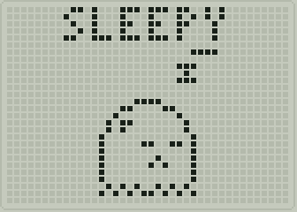 | 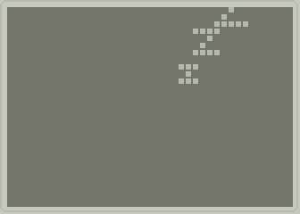 | 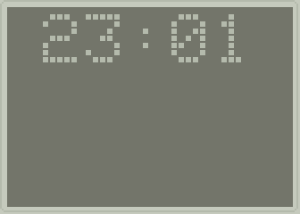 |

**Bedtimes** (by the device's clock):

| Stage | Asleep |
| --- | --- |
| Lil Blob | 8:00 pm to 10:00 am |
| Lil Blub | 9:00 pm to 9:00 am |
| Lil Blunkus | 9:30 pm to 8:30 am |
| Lil Fella, Big Blorbus | 10:00 pm to 8:00 am |

A brand new Lil Blob's bedtime waits 30 minutes, so one made at night can be looked after first.

**What it does**

- Hunger and happiness barely drop, health doesn't drop at all, and they hold their poop until morning.
- **They want the light off.** Asleep with it on, the attention icon lights and says `SLEEPY`. Leaving it on for 15
  minutes is a care mistake; for more than 15% of the night, [light sickness](#sick) in the morning.
- With the light off the screen is dark, with only the Zs. Nothing
  can be touched, but a tap shows the time.
- Play is refused (`ZZZ`). So is food, unless they're under 40% full: a hungry fella wakes for a meal and dozes off
  again.
- Growing up waits until they're awake with the light on.
- In the morning they wake and the light comes back on by itself.

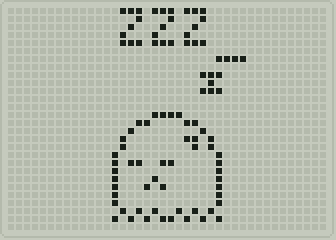

## Napping (in the day)

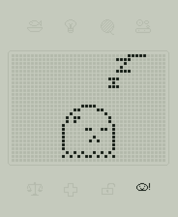

Looks the same as night sleep, but it's the day. Only one thing causes it:

| Cause | Ends when |
| --- | --- |
| **The test nap:** every Lil Blob gets sleepy at 6 to 9 minutes old (the light lesson) | After 10 minutes, or about 7 with the light off. If you didn't turn the light off while they slept, another nap comes 3 minutes after they wake, until you do |

Once the light lesson is learned there are no more daytime naps, for the rest of their life.

> **There is no energy.** Until v0.10 they had a hidden energy level: every game used some up, under 12 (of 100) they
> fell asleep, and under 10 they refused to play (`TIRED`). A young fella needs a lot of games to stay happy, so one
> that was played with properly was asleep much of the day. Energy is gone: **games are free, play as many as you
> like**, nothing wears them out, and they never nap from tiredness. Turning the light off in the day no longer
> sends them to sleep either; it just makes the room dark.

A napping fella can't be played with or petted.

## Calls (the attention icon)

The attention icon (bottom right, a blob with a `!`) lights when they need something. Tap it and the LCD says what.
If several things are wrong it names the most urgent, in this order:

| Says | Means | Picture | Fix |
| --- | --- | --- | --- |
| `HUNGRY` | Under 15% full | 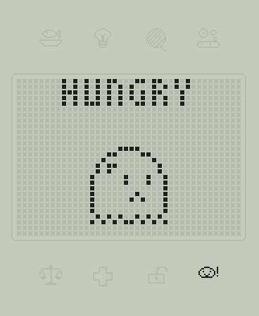 | Feed |
| `BORED` | Happiness under 15 (only while awake) | 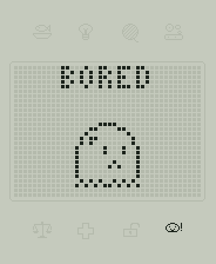 | Play, or pet them |
| `SICK`, `SICK X2`... | One or more [sicknesses](#sick) |  | Medicine |
| `MESSY` | Anything on the floor, or 3 or more in the box | 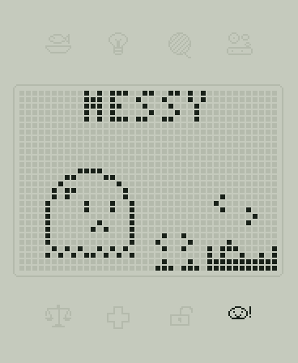 | Clean (the soap, or tap the box) |
| `SLEEPY` | Asleep with the light on | 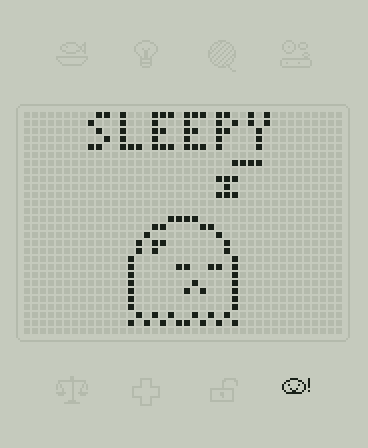 | Light off |
| `UPSET` | Trust is low (see below) | 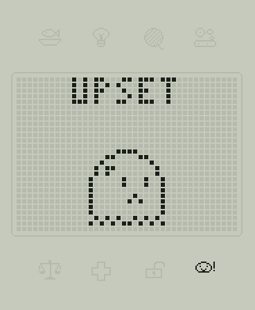 | Look after them; it mends slowly |
| `HELLO!`, `CHECK ME` | A first-hour lesson: a Lil Blob asking you to try an icon | 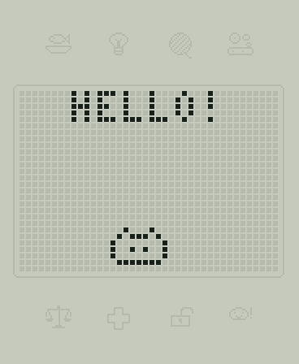 | Tap the icon it wants |

When nothing is wrong the icon is off, and tapping it shows nothing.

A HUNGRY, BORED, MESSY, SLEEPY or SICK call left for **15 minutes** is a care mistake, and one more for every further
hour.

### Hungry

- **At zero:** [hunger sickness](#sick), trust drains fast, and they lose weight.
- **Under 20%:** trust drains, and they age 35% faster.
- A completely full fella (over 98%) refuses a meal. Feeding one that's already 85% full or more is overfeeding: a
  little health and happiness lost each time, and weight gained (see [Overfed](#overfed-hidden)).
- Big Blorbus never gets hungry.

### Bored, and sad

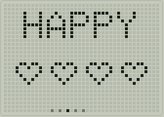

- **Happiness under 20:** they age 35% faster. **Under 10:** trust drains.
- **At zero, awake:** sadness builds, 10 minutes at a time. After **6 hours** in a row there's a sad sound. After
  **12 hours** in a row the life ends: **Too sad**.
- Getting them back up to **half happy** clears the sadness completely. Sleep doesn't count toward it.
- There's no picture for sadness on the home screen: check the Meter's HAPPY page. No hearts at all is the danger sign.

### Messy

- **Three poops in the box** is tolerated (that's a day's worth). **Four or more:** health and trust drain.
- **Floor mess older than 20 minutes:** health and trust drain, faster with more of it.
- A content fella always uses the box. One that's upset (trust lost past 60 with two or more already in the box, or
  past 85 whatever the box) goes on the floor in protest, with a grumble.
- **Every poop stays in the box until it's cleaned**, up to 12. Past six the pile becomes a swaying tower, with a
  fly at 8, a flag on top at 10 and a second fly at 11. More poop is more scrubbing: about 2 s for one, and a
  second more for each one after it.

### Upset (trust)

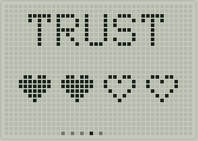

Trust is the Meter's TRUST page. It's lost slowly through neglect: going hungry, being bored, mess left lying, very
low health.

| Trust lost | What happens |
| --- | --- |
| 60% | A sad sound; the attention icon says `UPSET`; they may poop on the floor |
| 85% | Another sad sound; they always poop on the floor |
| 100% | The life ends: **Lost trust** |

It comes back at about 3.5 points an hour while they're well kept. Petting, playing and medicine each give a little
back straight away. Lost trust also makes them age faster (up to 80% faster at the worst).

---

## Locked

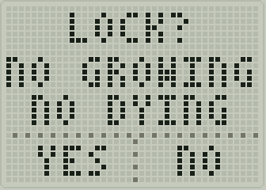 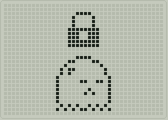 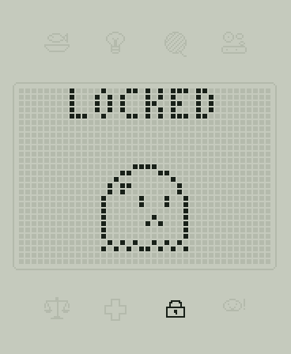

**Cause:** you tapped the padlock and answered YES.

**What it does:** they don't age, don't grow into the next stage and can't die, of anything. Everything else carries
on: they still get hungry, messy, sick and sleepy, and still call for you. The padlock stays lit.

**How to clear it:** tap the padlock again (`UNLOCK?`). Life goes on from where it stopped. A badly neglected fella
gets a little health and trust back at that moment, so nothing ends the second you unlock.

## Exploring, and gifts

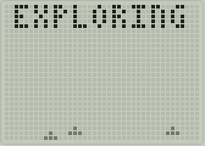 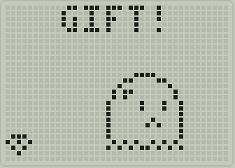

From Lil Blunkus on, a content fella (happiness 30 or more, a quarter full or more, health 30 or more) slips out
every 1½ to 4 hours.

- **While they're out** (2 to 4 minutes): a goo trail on the floor and no fella. Feed, Play, Medicine and Clean all
  answer `OUT`. The attention icon stays off.
- **When they're back:** often with a treasure, bottom left: a flower, a shell, a pebble, a berry or, rarely, a gem.
  The healthier they are, the more often they find something (55% of trips at health 0, 95% at full health).
- **Tap the treasure** to take it (`THANKS!`, and they like that). Left for 15 minutes, it's gone.

## Void

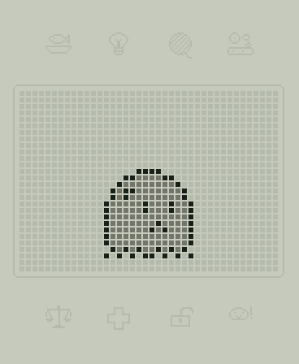 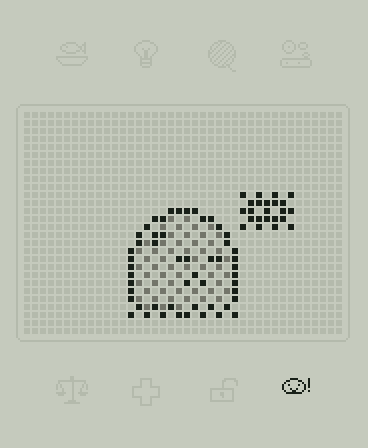

At one day old a hidden breed is decided by how they've been cared for so far. A fella that spent half or more of
that day neglected (hungry, bored, upset, or with mess about) becomes **Void**, and from Lil Blunkus on is drawn
filled in dark grey. It's permanent and only cosmetic, apart from the breed's small effect on weight. A sick Void
fella gets a light speckle instead of a dark one.

## Overfed (hidden)

There's nothing to see. Weight is tracked out of sight; meals given to a fella that's already 85% full or more add to
it quickly. Far too much for far too long drains health, speeds up ageing, and in the end is one of the endings:
**Overfed**. Games work a little of it off.

---

## How a life ends

Each ending starts with a caption, then they melt into a puddle and the dropper comes down for it.

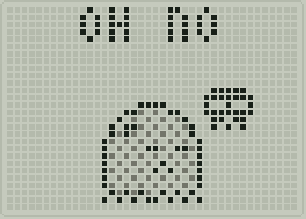 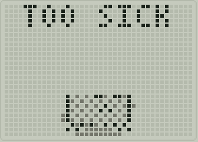 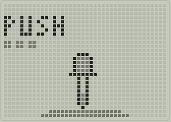

| Caption | Cause | The status effect behind it |
| --- | --- | --- |
| `TOO SICK` | Health reached zero | [Sick](#sick), [Weak](#weak-the-skull) |
| `TOO SAD` | 12 awake hours in a row at zero happiness | [Bored, and sad](#bored-and-sad) |
| `NO TRUST` | Trust ran out | [Upset](#upset-trust) |
| `OVERFED` | Weight reached its limit | [Overfed](#overfed-hidden) |
| `THANK YOU` | Old age, about a month (sooner with poor care) | None: a good life |

None of these can happen while they're [locked](#locked), while they're asleep (health and sadness only build
awake), or while the device is off.
